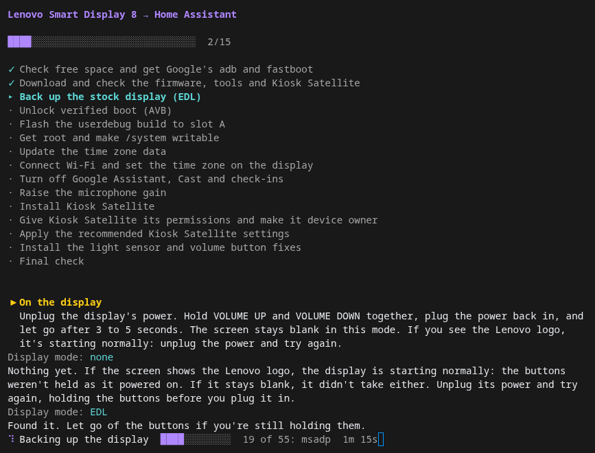
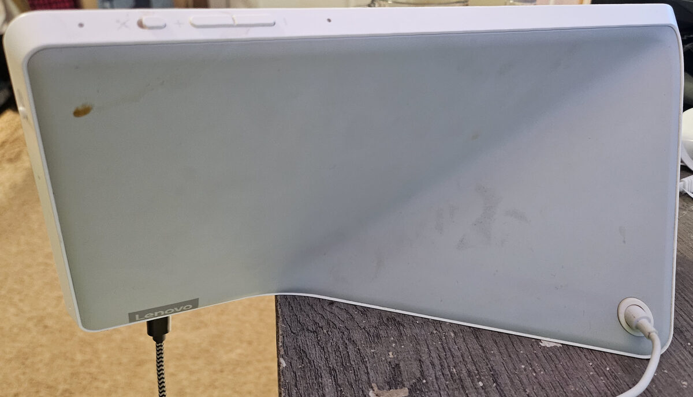

# Guide

Every page in one place, in the order you'll need them.

## How setup goes

```text
 Your computer                 The display
 -------------                 -----------
 1. Download and unzip lhk
 2. Run: lhk setup
       |
       |-- backup ------------>  EDL mode (screen black)
       |-- unlock, flash ----->  fastboot mode (screen black)
       |-- root, settings ---->  starts the new system
       |                         you: Wi-Fi and time zone
       |-- Kiosk Satellite --->  you: Home Assistant sign-in
       |-- final check
       v
 3. Keep the backup zip        Home Assistant dashboard
```

The tool tells you each time it needs you at the display. The screen stays black in EDL and fastboot modes:
that's normal.

## What you'll see



One screen that redraws as setup goes: a bar, every step with a ✓ when it's done, and the current one
highlighted. Under it, the job in progress counts up, such as "19 of 55" for the backup.

- **Yellow is your turn.** An "On the display" box says what to do there, with the buttons in bold. A yellow
  question waits for you to type or press Enter.
- **Display mode** shows which mode the display is in while the tool waits for it. It keeps waiting as long
  as you need: press Ctrl-C to stop.
- **Red means something went wrong.** The tool shows the last lines of its log and where the log is saved.

## Before you start

Pick the guide for your computer:
- [Windows](WINDOWS.md), with [USB drivers](drivers.md)
- [Mac](MACOS.md) (Apple silicon)
- [Linux](LINUX.md)
- [Running from source](PYTHON.md): any computer with Python 3.10 or newer, including Intel Macs

New to this? [Words you'll see](../README.md#words-youll-see) explains the terms.

### Plugging in the USB cable



The USB-C port is under the rubber cover at the bottom right of the display's back. The photo is taken from
behind, so there it's on the left, by the Lenovo logo. The power socket is the round one at the other end. The USB plug points straight down, so let that end of the display hang over a table edge, as in
the photo, or stand the display on its end.

## During setup

- The [manual](../devices/amber/README.md) has the same steps as the tool, numbered the same way, each with
  the check that proves it worked. Read it to see what a step does, or to do it by hand.
- If the tool stops, run the same command again. It carries on where it left off.

## After setup

- [Turning the screen off](SCREEN.md), with tap to wake.
- [Fitting more on the screen](SIZE.md): Kiosk Satellite's zoom, not Android's screen density.
- [Time zones](TIMEZONES.md), and why a dashboard can show a time an hour off.
- Kiosk Satellite's settings: on the display, or in a browser at `http://<the display's address>:2324`. The
  tool shows the address at the end.
- To go back to Google's software: `lhk restore`, explained under "How it works" in the [README](../README.md#how-it-works).

## If the display doesn't show up on USB

On any computer: after the flash, the display can stay off USB until its USB cable is unplugged and plugged
back in. The tool asks you to do that when it's needed:

1. Unplug the USB cable from the display, count to 3, and plug it back in. Leave the power plugged in.
2. Still nothing? Try a USB-A port on the computer, with a USB-A to USB-C cable. A computer with no USB-A
   ports, such as most Macs, needs a USB-A hub or adapter for that.
3. Or flip the plug at the display end.

The four dots on the display can keep spinning even when it's ready, so they don't mean it's stuck.

## Problems or questions

Ask in the [Home Assistant Community thread](https://community.home-assistant.io/t/lenovo-smart-display-8-as-a-de-googled-ha-dashboard-running-kiosk-satellite-w-assist-working-testers-wanted/1033810) or the [XDA thread](https://xdaforums.com/t/lenovo-smart-display-8-home-assistant-kiosk-satellite.4808181/) (no GitHub account needed), or [open an issue](../../../issues). Say which computer you used, how far it got, and copy the last lines the tool printed.

[What's changed](../CHANGELOG.md) lists what's new in each version.
